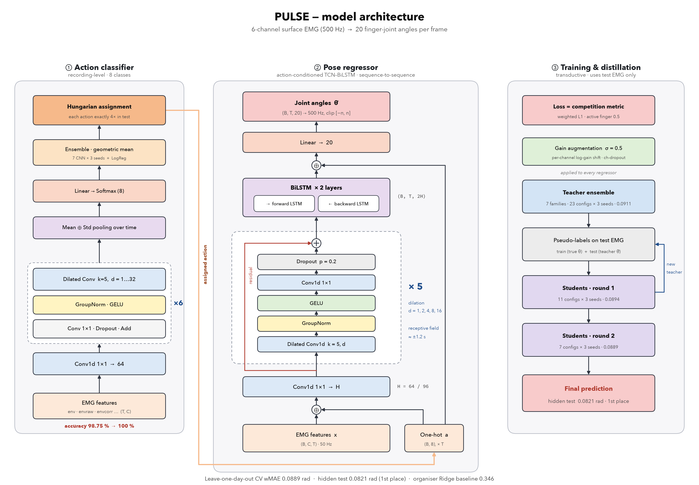

## Результат

**Скрытый тест этапа 2: wMAE = 0.0821 рад — 1-е место** (2-е место — 0.1073, бейзлайн организаторов — 0.346).

## Архитектура

## Презентация

- [`presentation/PULSE_presentation_full.pdf`](presentation/PULSE_presentation_full.pdf) — полная презентация: основная часть + слайды для ответов на вопросы.
- [`presentation/PULSE_presentation.pdf`](presentation/PULSE_presentation.pdf) — основная часть (13 слайдов); отдельные слайды — в `presentation/slides/`.

## **airi-emg-hand-decoding** — основной файл с решением

В нём основная модель (финальный ансамбль `final_v4`) и её облегчённые версии `simple.py` и `lite.py`.

- Запуск финала: `python final.py --test-dir data/test --template data/phase2_sample_submission.csv --out outputs/phase2_final.csv --config configs/final_v4.json --model-dir models`
- Описание решения: `README.md`, `HANDOFF.md`, `EXPERIMENTS.md`, `CHEATSHEET.md` внутри папки.

## **Pulse-app** — приложение с обученной lite-версией модели

Развёрнуто на RailWay:
https://pulse-app-production.up.railway.app

(ссылка актуальна до 21.12.2026)

### P.s: вся документация к моделям указана в .md файлах в папках проекта.
*(запуск, их различия, эксперименты, итоговые результаты точности, текущее состояние модели)*